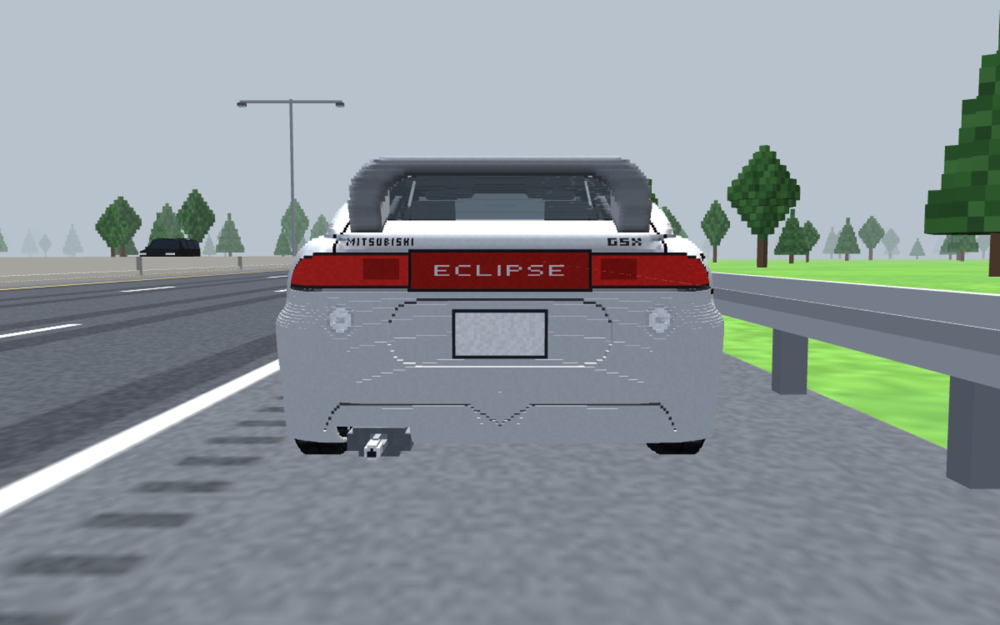
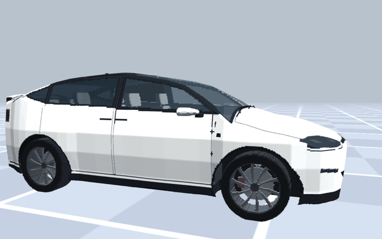

# Voxel Garage

**Drive it. Park it. Modify it.**

Seven real cars, built cube by cube at their real size. Open the garage and swap the engine, bolt on a turbo, drop it on coilovers, paint it any colour. The shop checks every part against the real car before it lets you drive away. Then take it out on the highway and feel what you built.

**▶ [Play in your browser](https://uncannycannibal.github.io/Voxel-garage/)**
- Chrome or Edge on a computer. On a touch screen, on-screen pedals and steering appear, and game controllers work too.
- Nothing to install.
- Sound starts off: switch it on in the menu under Drive and view.


## Seven cars, built to the millimetre

Every car is made of 10 mm cubes and modelled from real measurements: the body, the engine bay, the suspension and the interior.

- **BMW E30 325i** (1982–1994)
  - 2.5 L M20 inline-6, 170 hp; Getrag five-speed, rear drive.
  - Its turbo kit bolts into the bay, with a T3/T4 turbo, pipes and an intercooler.
- **BMW E30 325i Touring** (1988–1994)
  - The same drivetrain in the five-door estate.
  - Rear doors and a tailgate that open.
- **Honda Civic EF SiR** (1988–1991)
  - 1.6 L B16A with VTEC, 158 hp, revving to 8,000; front drive.
  - Listen for the intake changing note when VTEC opens at 5,500 rpm.
- **Nissan Fairlady Z Twin Turbo (Z32)** (1989–2000)
  - 3.0 L VG30DETT, two turbos, 276 hp; viscous limited-slip rear.
  - The T-top glass panels come out.
  - Upgrade to GT2860RS twins.
- **Toyota Sprinter Trueno AE86** (1983–1987)
  - 1.6 L 4A-GE, 128 hp, revving to 7,600; rear drive.
  - Pop-up headlights.
  - A T25 turbo kit, with or without a front-mount intercooler.
- **Mitsubishi Eclipse GSX** (1997–1999)
  - 2.0 L 4G63T turbo, 210 hp; all-wheel drive.
  - Upgrade to an Evo III 16G turbo.
- **Tesla Model X Plaid** (2022 on)
  - Three electric motors, 761 kW (1,020 hp).
  - Falcon-wing doors that fold and lift.
  - A yoke and a driver's screen.


**Coming soon:** Toyota 2000GT, Jeep Grand Cherokee Trackhawk, Jeep Wrangler, Dodge Challenger Hellcat.

## Build the car you'll drive

The garage's parts library holds:

| Parts | Count |
|---|---|
| Engines | 36 |
| Gearboxes | 19 |
| Diffs | 14 |
| Turbo setups | 17 |
| Exhausts | 16 |
| Wheels | 24 |
| Tyres | 5 |
| Brake kits | 18 |
| Suspension setups | 6 |
| Seats | 24 |
| Steering wheels | 14 |
| Aero, wings, flares and skirts | yes |
| Roll cages and nitrous | yes |

Engines can move between cars: the shop tells you what the swap needs, such as a swap kit or a gearbox that bolts to it.

- **Stance:** set the ride height, camber and wheel offset.
- **Paint:** any colour, in gloss, metallic or matte, with window tint.

## Every part has to fit

This is a garage with rules: every part is checked against the real car.

**What's checked**
- Does the engine fit the bay and the mounts?
- Does the gearbox bolt to it?
- Can the gearbox take the torque?
- Do the wheels clear the arches and the brakes?
- Is that turbo kit even made for this engine?

**What happens when a part fails**
- The shop says why in plain words, for example: *"Getrag 260 five-speed (stock) is rated about 300 Nm; the M20B25 makes 330 Nm with the M20 turbo kit."*
- A part that can't work keeps the car from starting until you fix it.
- Wheels that rub or poke are a warning, not a block: it's your car.

## Drive what you built

- **The handling comes from the parts:** tyre grip, weight transfer, brake fade, aero and the diff are all simulated, so stance, tyres and power change how the car feels.
- **The drivetrain shows:**
  - a rear-drive car with an open diff eases out of corners;
  - a limited-slip one breaks loose;
  - front drive pushes wide and tucks in when you lift;
  - all-wheel drive holds on.
- **Steering:** each car uses its own steering ratio and lock.
- **Assists:** Normal, Drift or Off.
- **Where to drive:** a parking lot, and a highway with traffic.
- **Cameras:** chase, orbit, or the driver's seat with live mirrors.

## Hear it

Each engine sounds like itself, because its cylinders fire in the real firing order: the inline-6, the fours and the V6 each have their own note. You'll also hear:
- the change on and off the throttle;
- the intake, and the B16A's VTEC change at 5,500 rpm;
- the turbos whistling and their bypass valves letting go;
- the rev limiter and every gear change;
- the tyres, the road and the wind;
- the Model X's motor whine.

## Open everything

Doors, hood, hatch and rear doors all open. The windows wind down. The lights, hazards and wipers work, and the steering wheel comes off. On top of that, each car has its own: the Z32's T-tops come out, the AE86's lamps pop up, and the Model X's wings fold and lift.

| | |
|---|---|
|  |  |
|  |  |

## Built with AI, checked at every step

Voxel Garage was built by one person directing AI coding agents, under one rule: nothing counts as done until it's checked.

- **Numbers come from published specs,** checked against more than one source where possible. Every number in the code says how sure it is: VERIFIED, MEASURED, CALCULATED, DESIGN or ESTIMATED.
- **Automated checks run the real game in a browser.**
  - Every car is checked with its doors, hood and hatch open and the suspension settled, looking for overlapping parts, loose pieces and broken shapes.
  - Then every car drives the highway in heavy traffic.
- **The same checks are in the game:** "Check this build" (View tab) runs them on whatever you've built.

## Controls

| Key | Does |
|---|---|
| W / ↑ | Throttle |
| S / ↓ | Brake; reverse from a stop |
| A / D or ← / → | Steer |
| Space | Brake |
| Shift or E | Handbrake |
| H | Lights |
| Z | Hazards |
| C | Camera view |
| G | Garage / drive |
| N | Arm nitrous |

Drag to orbit, and scroll or pinch to zoom. In the driver's view, hold Space and use W A S D (or drag) to look around.

**Controller:** plug in a DualShock 4, DualSense, Xbox or most other pads (Chrome, Edge or Firefox) and press any button. Steering, gas and brake are analog.

| Pad | Does |
|---|---|
| Left stick | Steer |
| R2 / RT | Gas |
| L2 / LT | Brake; reverse from a stop |
| Cross / A | Handbrake |
| Circle / B | Camera view |
| Triangle / Y | Lights |
| Square / X | Arm nitrous |
| L1 / LB | Hazards |
| Options / Start | Garage / drive |
| Right stick | Camera; look around in the driver's view |
| R3 | Look ahead again |

## Build and check it yourself

```
python gar/build_garage.py        builds gar/out/garage.html; open it in Chrome or Edge
```

The checks run the page in a real browser.
- Setup, once: `pip install playwright`, then `python -m playwright install chromium`, then `npm install` inside `t/`.

```
python gar/check.py               build, then check every car
python gar/check.py ae86          one car
python gar/check.py --full        doors, hood and hatch open, suspension settled
python t/traffic_smoke.py --all   every car on the highway in busy traffic
```

Nothing is called done until `check.py` ends with `ALL PASS`. When a check fails, `python t/where.py` shows where. The 2000GT (coming soon) is still being rebuilt and fails its check; the seven cars on the list pass.

## About

This is a fan project. Car names, model names and the badges on the cars belong to their makers. It is not affiliated with or endorsed by any of them.

## License

All rights reserved (see [LICENSE](LICENSE)). You're welcome to read the code and play the game. Please ask before reusing any of it.
