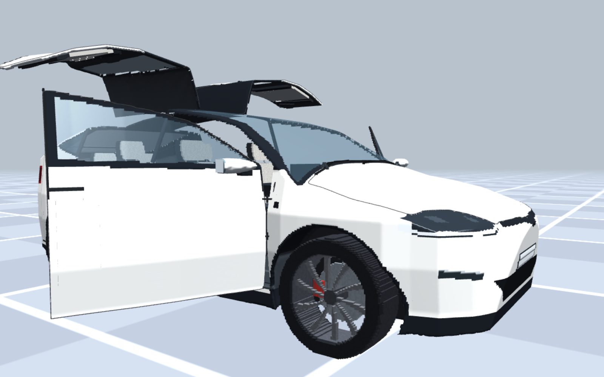
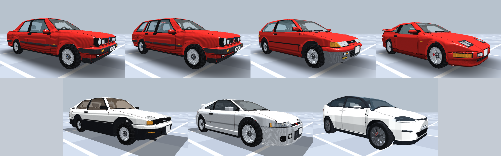
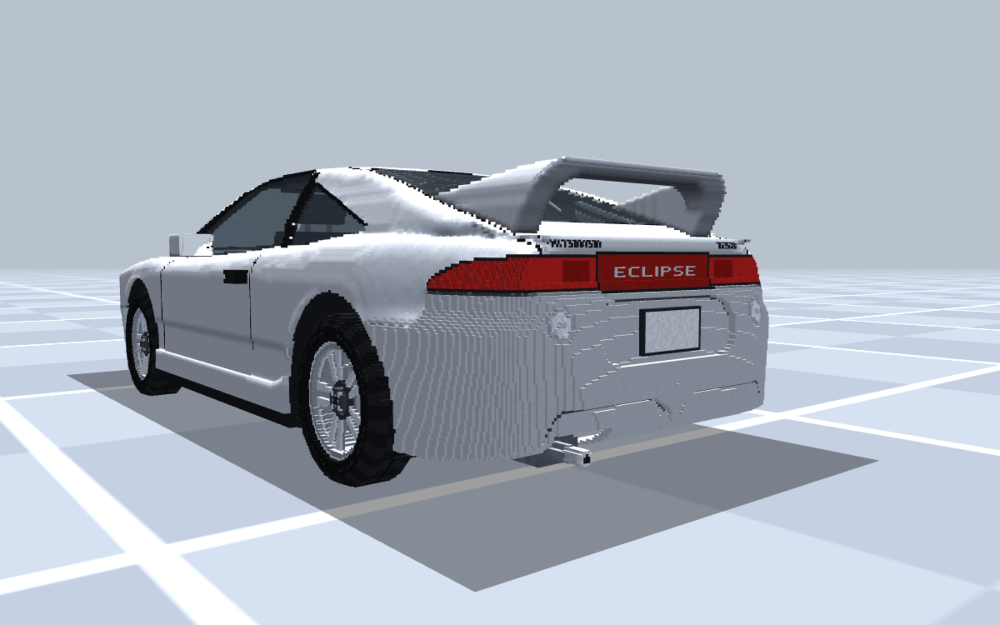
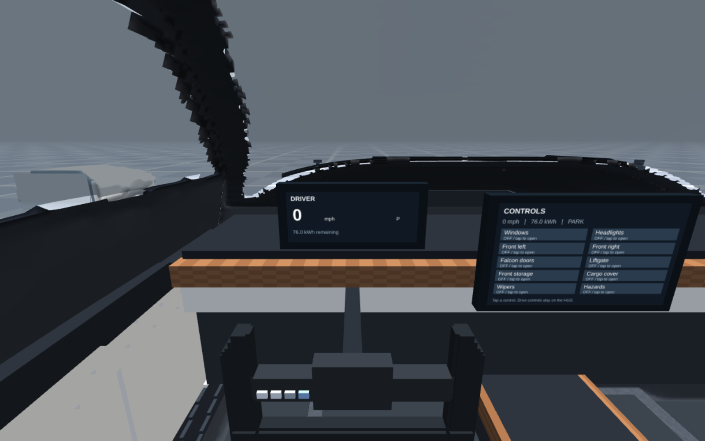

# Voxel Garage

**Drive it. Park it. Modify it.** A voxel car garage in the browser. Every car is built to real measurements, every part has a real fitment rule, and every change shows up in how the car drives.

**▶ [Play in your browser](https://uncannycannibal.github.io/Voxel-garage/)**: Chrome or Edge on a computer. On a touch screen, on-screen pedals and steering appear. Sound starts off: turn it on in the menu under Drive and view.





| | |
|---|---|
|  |  |
|  |  |

## What's in it

- **Cars built to real dimensions** in 10 mm voxels.
  - Doors, hood and hatch open.
  - The suspension works.
  - The engine bay and the interior are modelled.
  - The Model X's falcon-wing doors fold and lift.
- **A mod shop that checks fitment.** It covers:
  - engine swaps, gearboxes, diffs and turbos;
  - wheels and tyres, camber and offset;
  - brakes, suspension, seats and cages;
  - aero, exhausts and nitrous.

  The shop says whether a part fits and why. If it doesn't fit, the car won't start. Turbo kits are fitted in the bay, with their pipes and intercooler.
- **Driving that reacts to the build.** Tyre grip, load transfer, brake fade, aero and diff behaviour are all modelled, so stance, tyres and power change how the car handles. Rear-, front- and all-wheel drive each behave like their drivetrain. Each car steers with its own steering ratio and lock. Driving assists: Normal, Drift or Off.
- **Engines that sound like themselves.** Each cylinder fires in the engine's real firing order, so an inline-6, a four and a V6 each have their own note. It also covers on and off the throttle, the intake, VTEC, turbo whistle, road and wind.
- **A world:** a parking lot, and a highway with traffic.
- **Built-in checks.** "Check this build" (View tab) finds overlapping parts and loose pieces. The "Cube kit" turns any car into a buildable cube list.
- **Numbers carry where they came from.** Dimensions in the source are labelled VERIFIED, MEASURED, CALCULATED, DESIGN or ESTIMATED.

## Cars

| Car | Years | Layout |
|---|---|---|
| BMW E30 325i coupe | 1982-1994 | front engine, rear drive, inline-6 |
| BMW E30 325i Touring | 1988-1994 | front engine, rear drive, inline-6, five doors |
| Honda Civic EF hatchback | 1988-1991 | front engine, front drive, transverse four |
| Nissan Fairlady Z / 300ZX (Z32) | 1989-2000 | front engine, rear drive, twin-turbo V6 |
| Toyota Sprinter Trueno AE86 | 1983-1987 | front engine, rear drive, 4A-GE |
| Mitsubishi Eclipse GSX | 1997-1999 | front engine, four-wheel drive, turbo four |
| Tesla Model X Plaid | 2022+ refresh | three motors, all-wheel drive, falcon-wing doors |

**Coming soon:** Toyota 2000GT, Jeep Grand Cherokee Trackhawk, Jeep Wrangler, Dodge Challenger Hellcat.

## Controls

| Key | Does |
|---|---|
| W / ↑ | Throttle |
| S / ↓ | Brake; reverse from a stop |
| A / D or ← / → | Steer |
| Space | Brake |
| Shift or E | Handbrake |
| H | Lights |
| Z | Hazards |
| C | Camera view |
| G | Garage / drive |
| N | Arm nitrous |

Drag to orbit, and scroll or pinch to zoom. In the driver's view, hold Space and use W A S D (or drag) to look around.

**Controller:** plug in a DualShock 4, DualSense, Xbox or most other pads (Chrome, Edge or Firefox) and press any button. Steering, gas and brake are analog.

| Pad | Does |
|---|---|
| Left stick | Steer |
| R2 / RT | Gas |
| L2 / LT | Brake; reverse from a stop |
| Cross / A | Handbrake |
| Circle / B | Camera view |
| Triangle / Y | Lights |
| Square / X | Arm nitrous |
| L1 / LB | Hazards |
| Options / Start | Garage / drive |
| Right stick | Camera; look around in the driver's view |
| R3 | Look ahead again |

## Build and check it yourself

```
python gar/build_garage.py        builds gar/out/garage.html; open it in Chrome or Edge
```

The checks run the page in a real browser.
- Setup, once: `pip install playwright`, then `python -m playwright install chromium`, then `npm install` inside `t/`.

```
python gar/check.py               build, then check every car
python gar/check.py ae86          one car
python gar/check.py --full        doors, hood and hatch open, suspension settled
python t/traffic_smoke.py --all   every car on the highway in busy traffic
```

Nothing is called done until `check.py` ends with `ALL PASS`. When a check fails, `python t/where.py` shows where. The 2000GT (coming soon) is still being rebuilt and fails its check; the seven cars on the list pass.

## About

This is a fan project. Car names, model names and the badges on the cars belong to their makers. It is not affiliated with or endorsed by any of them.

## License

All rights reserved (see [LICENSE](LICENSE)). You're welcome to read the code and play the game. Please ask before reusing any of it.
